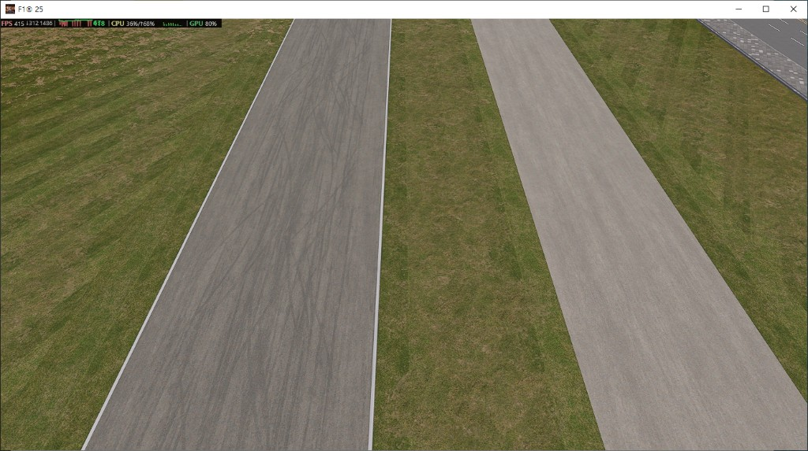
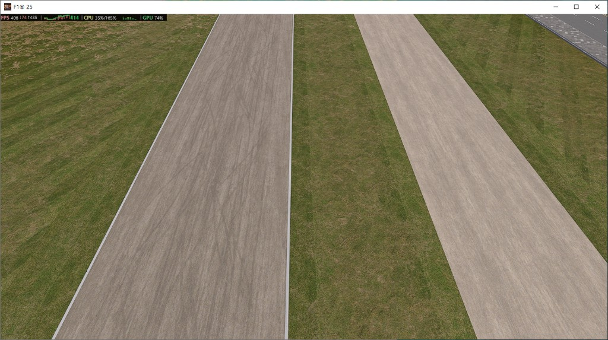

# Track surface and tyre marks

The build dialog can replace the carrier asphalt and the dark tyre-mark strip with one of the extracted game surfaces. Both pictures are the same straight. The first uses the Abu Dhabi surface and Abu Dhabi tyre marks, the second the Portimão carrier.

